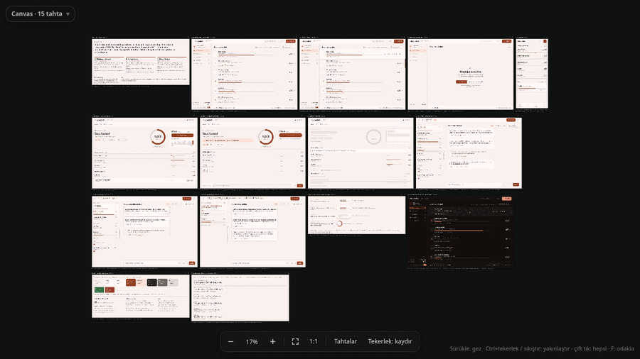
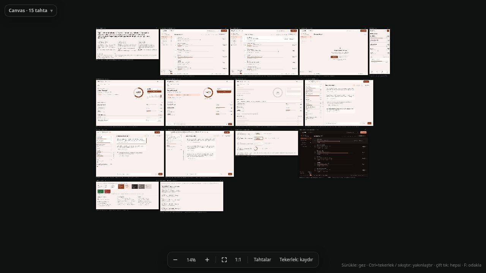
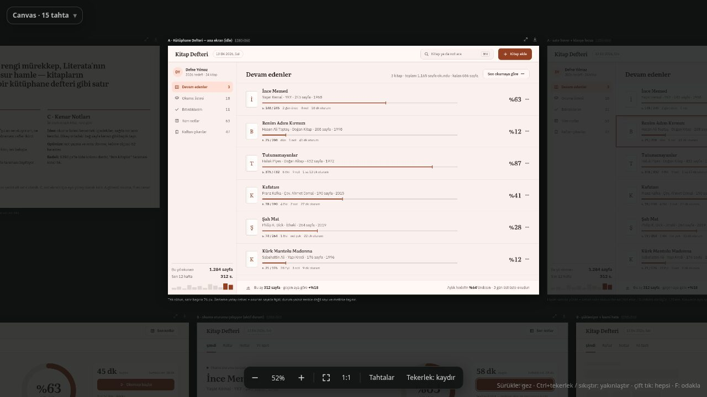
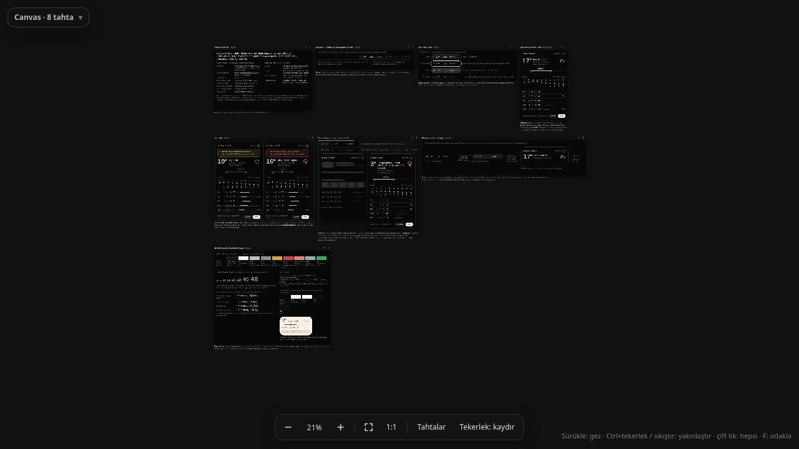
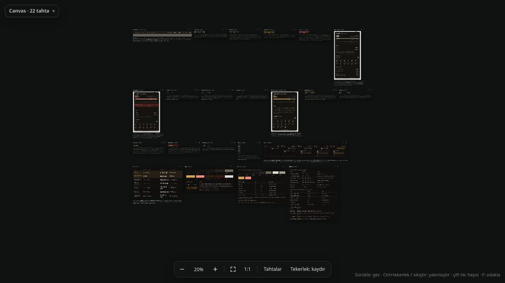

# Spec Mockup Design

**Yapay zeka ajanlarına "AI slop" yerine gerçek arayüz tasarlatan bir skill.**
Claude Code, Codex, opencode, Gemini/Antigravity, Cursor, Kiro, Qwen ve `SKILL.md` okuyan her ajanla çalışır.

[English](README.md) · [Canlı demo](https://lunanoir21.github.io/spec-mockup-design/) · MIT lisanslı



Bir ajandan "ayarlar ekranı tasarla" istediğinde genelde aynı sayfayı alırsın: mor gradyan, Inter yazı tipi, yuvarlak kartlar,
sol kenar çizgili kutular, lorem ipsum ve tek bir güzel durum. Bu skill onun yerine, insanların gerçekten beğenip kullandığı sonuçları üreten bir iş akışı koyar:

1. **Gerçek referansa dayan.** Projenin kendi kaynağından (veya adı verilen bir üründen) gerçek renk, radius, boşluk ve animasyon sürelerini çıkar. Gerçeği varken uydurma.
2. **Ruh hali değil tasarım dili kur.** Tek cümlelik konsept, OKLCH ile üretilmiş uyumlu palet, ölçek sistemi, tek kalınlıkta ikonlar.
3. **Her durumu göster.** Her gerçek durum için ayrı tahta: boşta, hover, boş, hata, yükleniyor, taşma, devre dışı, odak; ayrıca hareket storyboard'u, font karşılaştırması, tema seçici ve token tahtası.
4. **Slop kapısı.** Bir denetleyici puanlar, teslim fişi dosyaların gerçekten var olduğunu kanıtlar, ekran görüntülerine bakılır.
5. **Canvas teslim et.** Tasarım aracı olmayan ajanlar tek bir HTML **sonsuz canvas** üretir (sürükle, Ctrl+tekerlek ile yakınlaş, tahtaya odaklan, indir). Claude'un Design canvas'ı ile aynı deneyim.

| Genel bakış | Tahtaya odak |
|---|---|
|  |  |
|  |  |

[Canlı galeride](https://lunanoir21.github.io/spec-mockup-design/#gallery) farklı platformlar için sekiz canvas var: mobil alışkanlık takipçisi, satış paneli, macOS menü çubuğu uygulaması, tarayıcı eklentisi, oyun envanteri, web uygulaması, masaüstü widget'ı ve Linux çubuk widget'ı. Çoğu bu skill'i izleyen ücretsiz opencode modelleriyle üretildi. Birini açıp kendin gezebilirsin.

## Kurulum

Tek komut. Skill'i indirir ve hangi ajanlara kurulacağını seçtirir (makinende bulunan ajanlar önceden seçili gelir):

```bash
curl -fsSL https://raw.githubusercontent.com/lunanoir21/spec-mockup-design/main/install.sh | bash
```

Menüde numara yazarak aç/kapat, `a` hepsi, `d` bulunanlar, `n` hiçbiri, Enter başlat, `q` çık.
Etkileşimsiz: `bash install.sh --detected --yes`, `--agents claude,codex,opencode --yes`, `--all`, `--list`, `--dry-run`,
`--instructions` (`AGENTS.md`/`GEMINI.md` dosyasına tek satırlık yönlendirme de ekler), `--copy` (bağlantı yerine kopya),
`--uninstall` (yalnızca kendi koyduğu bağlantıları kaldırır). Var olan hiçbir şeyin üstüne yazmaz. Desteklenenler: Claude Code, Codex, opencode,
Gemini CLI, Antigravity, Cursor, Kiro, Qwen Code, zcode, pi, Qoder, Grok CLI, Hermes, jcode. Güncellemek için `git -C ~/.agents/skills/spec-mockup-design pull`.

Skills klasörü olmayan bir ajan için talimat dosyasına (`AGENTS.md`, `GEMINI.md`...) şu satırı ekle:

> Arayüz tasarımı veya mockup istendiğinde önce `~/.agents/skills/spec-mockup-design/SKILL.md` dosyasını yükle ve uygula.

Gereksinimler: Python 3.8+ (yalnızca standart kütüphane), ekran görüntüleri için Chromium veya Chrome (isteğe bağlı), `bash`.

## Kullanım

Ajanına tasarım iste, skill kendiliğinden devreye girer. İyi çalışan istemler ([docs/PROMPTS.md](docs/PROMPTS.md) içinde daha fazlası):

- `Hyprland üst barım için CPU sıcaklığı ve fan hızını gösteren bir widget tasarla. Boşta, uyarı ve kritik durumlarını göster.`
- `Kitap takip uygulaması için ana ekrana 3 seçenek tasarla. Seçenekler yapıca farklı olsun, sadece renkte değil.`
- `~/projeler/blackbox uygulamasına yeni bir Disk sayfası tasarla. Kaynağını oku, gerçek renk ve süreleri kullan, o klasörde hiçbir dosyayı değiştirme.`
- `Sadece TEK bir sakin yön istiyorum, seçenek yok. Nötr, neon ve gradyan yok.`
- `İlk seçenek en yakını. Hover durumunu netleştir, hata ve yükleniyor tahtalarını ekle.`
- `Tasarım onaylandı. Tokenları QML Theme singleton olarak aktar ve tahta başına bileşenleri listele.`


Ajan kısa bir script dizisi çalıştırır (`SKILL.md`'deki "quick path"): `palette.py`, `scales.py`, `new-canvas.py`, `slop-lint.py`, `shoot.sh`, `check-done.py`.

Canvas'ta gezinme: arka planı **sürükle**, **Ctrl+tekerlek** veya sıkıştır ile yakınlaş, **çift tık** hepsini sığdırır,
**F** tahtaya odaklar (ok tuşları sonraki/önceki, **Esc** geri), **0** sığdır, **1** %100, **Tahtalar** listesi ile atla,
tahtanın indirme düğmesi onu tek başına HTML olarak kaydeder. `?only=<id>` tek tahta, `?flat=1` klasik kaydırmalı sayfa, `#<id>` tahtaya odaklı açar.

## İçerik

Dosya yapısı ve her scriptin görevi için [İngilizce README](README.md#what-is-inside) tablosuna bak.

## İşe yarıyor mu?

Ücretsiz opencode modelleriyle 9 gerçek ajan koşusu (istemde skill'in adı geçmeden): 8'inde skill bulunup kullanıldı, 5'i tam puan aldı.
Başarısızlıklar doğrudan düzeltmelere dönüştü (uydurma rapora karşı teslim fişi, boş tahta kuralı, ilk palet tarifini kopyalamaya karşı klişe kuralı). Script testleri 99/99 geçiyor.

Dürüst sınırlar: denetleyici zevki değil varsayılanları ölçer, ekran görüntülerine bakmak gerekir. Kalite modele bağlı; bazı modeller erken bırakıyor veya çok uzun cilalıyor.

## Katkı

Sorun ve PR'lar açık, bkz. [CONTRIBUTING.md](CONTRIBUTING.md). Değişiklikten önce `python3 tests/selftest.py` çalıştır.

## Lisans

[MIT](LICENSE)
